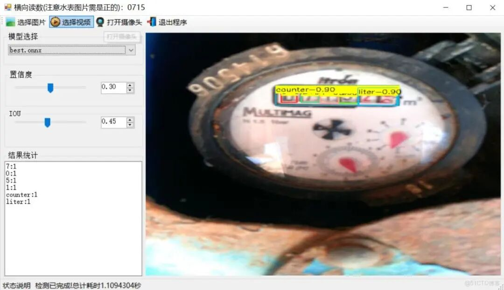
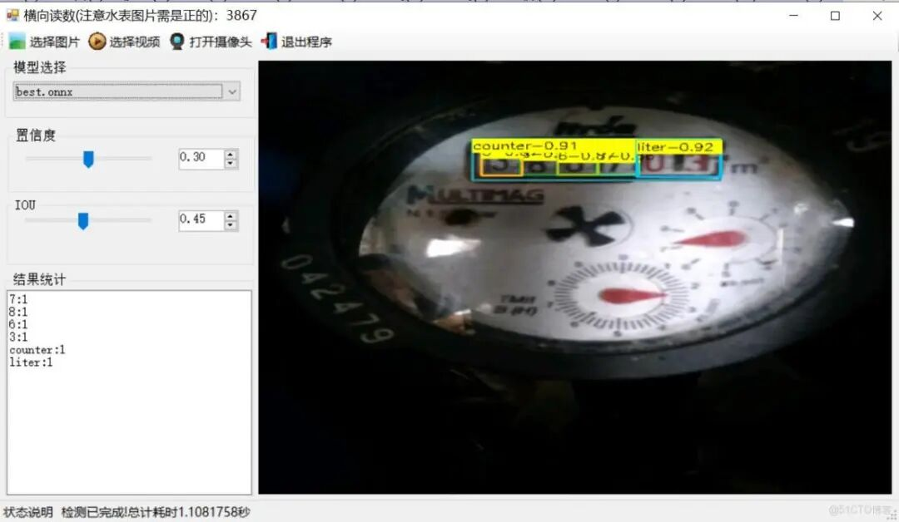
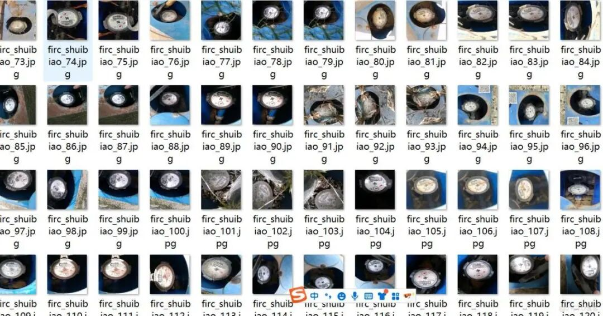
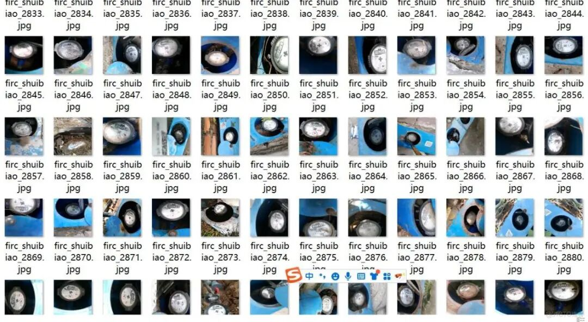
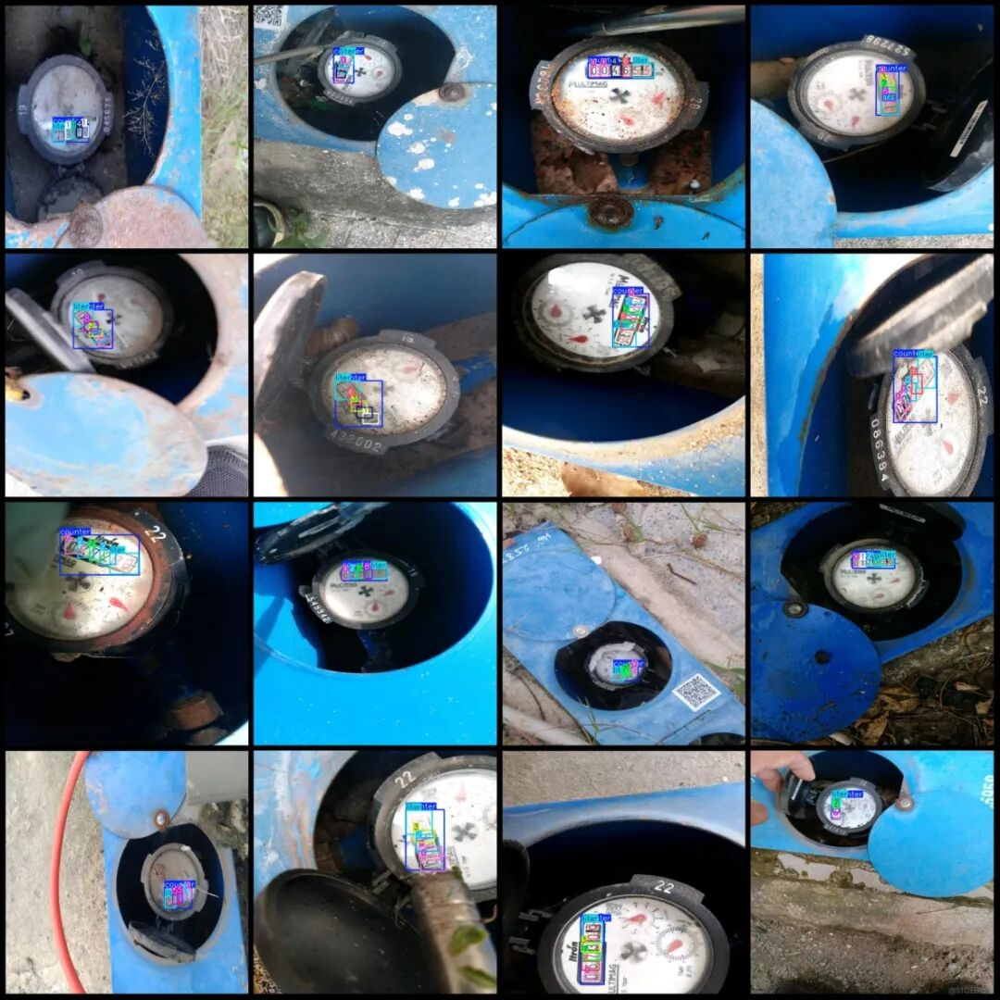
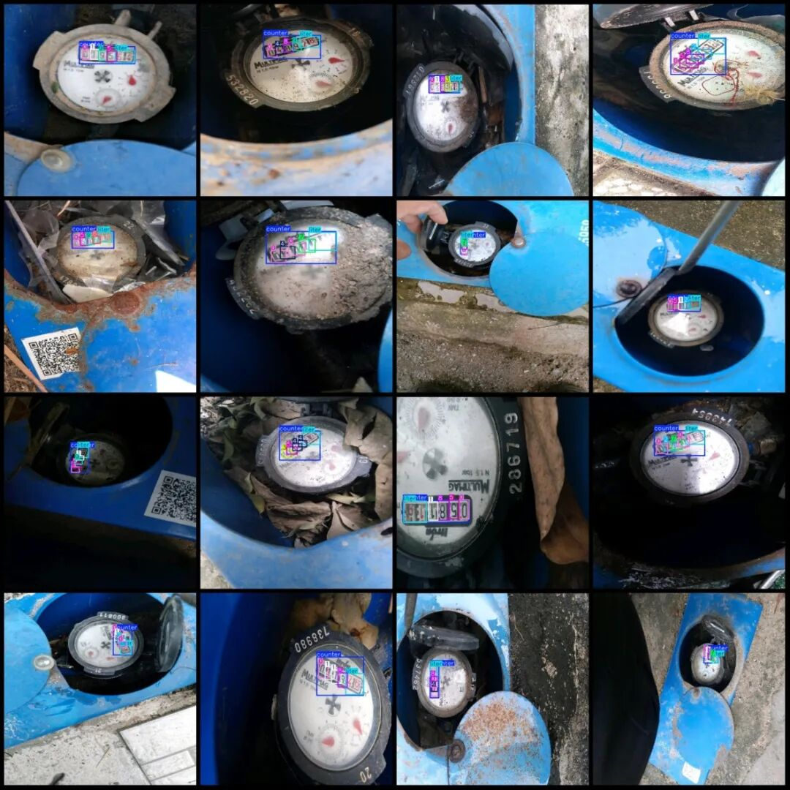

# [C#][Winform] Water Meter Reading Detection and Recognition System Based on YOLOv8 C# Source Code + ONNX Model + Evaluation Indicator Curve + High-quality GUI Interface

[Algorithm Introduction]The Water Meter Reading and Recognition System in Smart Water Affairs, based on the advanced YOLOv8 algorithm, provides a solid foundation for the intelligent upgrade of urban water supply management.

[Algorithm Introduction]

The water meter reading detection and recognition system in smart water management, based on the advanced YOLOv8 algorithm, provides solid technical support for the intelligent upgrade of urban water supply management. Through integrating the deep learning framework of YOLOv8, this system achieves real-time and precise identification of the digital and key indicators of water meters, covering core categories such as ["0","1","2","3","4","5","6","7","8","9","counter","liter"].

YOLOv8, with its outstanding detection speed and high precision, can quickly parse the digit information in water meters' images and precisely locate the counter area ("counter") and unit identification ("liter"). Through the YOLOv8 algorithm, feature information is automatically extracted to complete digital recognition and status judgment. Additionally, this system supports multi-scene adaptability and dynamic tracking functions, capable of simultaneously monitoring the reading changes of different models of water meters and compatibility with low light, reflection, and other complex environments. If the dataset is enhanced for training, it can further improve the level of meticulous management in water affairs.

In summary, A water meter reading detection and recognition system based on YOLOv8. Injects innovative momentum into the construction of smart water affairs. Effectively ensures the accuracy of water metering. Promoted the digital transformation of urban water resource management.

[Effect Display]





Note: The system employs the YOLOv8x large model for training, thus predicting a single image in approximately 1.1 seconds. If using YOLOv8n, the prediction time can be reduced to around 50ms. Since the direction of the water meter is uncertain, it must be placed in its positive orientation for normal reading of the complete water meter number. The code extracts the full number from left to right and displays it in the top-left area of the software. Only the integer part of the water meter is read, with the decimal part being detected but not recognized, as this primarily relies on object detection for positioning and recognition.

[Training Dataset Introduction]

Please note that the dataset contains many enhanced images, primarily rotation-enhanced ones.

Dataset format: Pascal VOC format + YOLO format (txt file without split path, only contains jpg images and corresponding VOC format xml files and yolo format txt files)

Number of images (number of jpg files): 3552

Number of annotations (number of xml files): 3552

Number of annotations (number of txt files): 3552

Label category count: 12

Label category names (note that the order of yolo format categories does not correspond to this, but is based on the labels folder's classes.txt): ["0", "1", "2", "3", "4", "5", "6", "7", "8", "9", "counter", "liter"]

Number of boxes labeled in each category:

0 Frames = 3865

1 Frames = 1768

2 Frames = 1390

3 Frames = 1295

4 Frames = 1198

5 Frames = 1074

6 Frames = 1019

7 Frames = 827

8 Frames = 908

9 Frames = 864

Counter frame count = 3552

Literal box count = 3551

Total frame count: 21311

Image resolution: 640x640

Using labelImg:

Annotation rules: Draw a rectangle around the category.

Important Notice: No

Special : This dataset does not guarantee the accuracy of the trained models or weight files.

Image Preview:





Annotation example:





[Test Environment]

Windows 10 x64 system, VS2019, netFramework4.7.2, OpenCVSharp4.9.0, ONNXRuntime1.22.0

[Training Information]


Parameters


Value


Number of training set images


3072


Number of images in the validation set


480


Training map


98.6%


Training Accuracy


96.5%


Training recall rate


96.6%


[Interface Design Code]

-
-
-
-
-
-
-
-
-
-
-
-
-
-
-
-
-
-
-
-
-
-
-
-
-
-
-
-
-
-
-
-
-
-
-
-
-
-
-
-
-
-
-
-
-
-
-
-
-
-
-
-
-
-
-
-
-
-
-
-
-
-
-
-
-
-
-
-
-
-
-
-
-
-
-
-
-
-
-
-
-
-
-
-
-
-
-
-
-
-
-
-
-
-
-
-
-
-
-
-
-
-
-
-
-
-
-
-
-
-
-
-
-
-
-
-
-
-
-
-
-
-
-
-
-
-
-
-
-
-
-
-
-
-
-
-
-
-
-
-
-
-
-
-
-
-
-
-
-
-
-
-
-
-
-
-
-
-
-
-
-
-
-
-
-
-
-
-
-
-
-
-
-
-
-
-
-
-
-
-
-
-
-
-
-
-
-
-
-
-
-
-
-
-
-
-
-
-
-
-
-
-
-
-
-
-
-
-
-
-
-
-
-
-
-
-
-
-
-
-
-
-
-
-
-
-
-
-
-
-
-
-
-
-
-
-
-
-
-
-
-
-
-
-
-
-
-
-
-
-
-
-
-
-
-
-
-
-
-
-
-
-

```
using DeploySharp.Data;using OpenCvSharp;using System;using System.Collections.Generic;using System.ComponentModel;using System.Data;using System.Diagnostics;using System.Drawing;using System.IO;using System.Linq;using System.Text;using System.Threading;using System.Threading.Tasks;using System.Windows.Forms;
namespace FIRC{    public partial class Form1 : Form    {
public bool videoStart = false;// Video stop flag
}        public string GetResultString(DetResult[] result)        {            Dictionary<string, int> resultDict = new Dictionary<string, int>();            for (int i = 0; i < result.Length; i++)            {                if(resultDict.ContainsKey( result[i].Category) )                {                    resultDict[result[i].Category]++;                }                else                {                    resultDict[result[i].Category] =1;                }            }
var resultStr = "";            foreach(var item in resultDict)            {                resultStr += string.Format("{0}:{1}\r\n",item.Key,item.Value);            }            return resultStr;        }        private void tsb_pic_Click(object sender, EventArgs e)        {            OpenFileDialog ofd = new OpenFileDialog();            ofd.Filter = "*.*|*.bmp;*.jpg;*.jpeg;*.tiff;*.tiff;*.png";            if (ofd.ShowDialog() != DialogResult.OK) return;            tssl_show.Text = "Detecting......";            Task.Run(() => {                var sw = new Stopwatch();                sw.Start();                Mat image = Cv2.ImRead(ofd.FileName);                detetor.SetParams(Convert.ToSingle(numericUpDown1.Value), Convert.ToSingle(numericUpDown2.Value));                var results=detetor.Inference(image);
var resultImage = detetor.DrawImage(image, results);
sw.Stop(); pb_show.Image = OpenCvSharp.Extensions.BitmapConverter.ToBitmap(resultImage); tb_res.Text = GetResultString(results); tssl_show.Text = "Detection completed!" Total elapsed time is "+sw.Elapsed.TotalSeconds+" seconds"; });
}
public void VideoProcess(string videoPath)        {            Task.Run(() => {
detetor.SetParams(Convert.ToSingle(numericUpDown1.Value), Convert.ToSingle(numericUpDown2.Value));                VideoCapture capture = new VideoCapture(videoPath);                if (!capture.IsOpened())                {                    tssl_show.Text="Video failed to open!";                    return;                }                Mat frame = new Mat();                var sw = new Stopwatch();                int fps = 0;                while (videoStart)                {
capture.Read(frame);                    if (frame.Empty())                    {                        Console.WriteLine("data is empty!");                        break;                    }                    sw.Start();                    var results = detetor.Inference(frame);                    var resultImg = detetor.DrawImage(frame,results);                    sw.Stop();                    fps = Convert.ToInt32(1 / sw.Elapsed.TotalSeconds);                    sw.Reset();                    Cv2.PutText(resultImg, "FPS=" + fps, new OpenCvSharp.Point(30, 30), HersheyFonts.HersheyComplex, 1.0, new Scalar(255, 0, 0), 3);                    // Display results
}
capture.Release();
pb_show.Image = null; tssl_show.Text = "Video has stopped!" "; tsb_video.Text = "Select Video";
});        }        public void CameraProcess(int cameraIndex=0)        {            Task.Run(() => {
detetor.SetParams(Convert.ToSingle(numericUpDown1.Value), Convert.ToSingle(numericUpDown2.Value));                VideoCapture capture = new VideoCapture(cameraIndex);                if (!capture.IsOpened())                {                    tssl_show.Text = "Camera failed to open!";                    return;                }                Mat frame = new Mat();                var sw = new Stopwatch();                int fps = 0;                while (videoStart)                {
capture.Read(frame);                    if (frame.Empty())                    {                        Console.WriteLine("data is empty!");                        break;                    }                    sw.Start();                    var results = detetor.Inference(frame);                    var resultImg = detetor.DrawImage(frame, results);                    sw.Stop();                    fps = Convert.ToInt32(1 / sw.Elapsed.TotalSeconds);                    sw.Reset();                    Cv2.PutText(resultImg, "FPS=" + fps, new OpenCvSharp.Point(30, 30), HersheyFonts.HersheyComplex, 1.0, new Scalar(255, 0, 0), 3);                    // Display results
}
capture.Release();
pb_show.Image = null; tssl_show.Text = "Camera has been stopped!" "; tsb_camera.Text = "Open Camera";
});        }        private void tsb_video_Click(object sender, EventArgs e)        {            if(tsb_video.Text=="Select video")            {                OpenFileDialog ofd = new OpenFileDialog();                ofd.Filter = "Video files(*.*)|*.mp4;*.avi";                if (ofd.ShowDialog() != DialogResult.OK) return;                videoStart = true;                VideoProcess(ofd.FileName);                tsb_video.Text = "Stop";                tssl_show.Text = "Video is being detected....";
}            else            {                videoStart = false;
}        }
private void tsb_camera_Click(object sender, EventArgs e)        {            if (tsb_camera.Text == "Turn on the camera")            {                videoStart = true;                CameraProcess(0);                tsb_camera.Text = "Stop";                tssl_show.Text = "Camera is in detection mode....";
}            else            {                videoStart = false;
}        }
private void tsb_exit_Click(object sender, EventArgs e)        {            videoStart = false;            this.Close();        }
private void trackBar1_Scroll(object sender, EventArgs e)        {            numericUpDown1.Value = Convert.ToDecimal(trackBar1.Value / 100.0f);        }
private void trackBar2_Scroll(object sender, EventArgs e)        {            numericUpDown2.Value = Convert.ToDecimal(trackBar2.Value / 100.0f);        }
private void numericUpDown1_ValueChanged(object sender, EventArgs e)        {            trackBar1.Value = (int)(Convert.ToSingle(numericUpDown1.Value) * 100);        }
private void numericUpDown2_ValueChanged(object sender, EventArgs e)        {            trackBar2.Value = (int)(Convert.ToSingle(numericUpDown2.Value) * 100);        }
private void comboBox1_SelectedIndexChanged(object sender, EventArgs e)        {            tssl_show.Text="Load model:"+comboBox1.Text;            detetor.LoadWeights(weightsPath+"\\"+comboBox1.Text);            tssl_show.Text = "Model loading is complete.!";        }    }}
```

```

```

[Usage Steps]

Usage Steps: (1) First, install the YOLOv8 environment according to the official framework ultralytics installation tutorial, and then convert your own pt model into an ONNX model using the official export command. Then, go to github.com/futureflsl/firc-csharp-projects to find the source code. (2) Open the Sln project in Visual Studio 2019, select x64 release, and modify some necessary parameters, such as input shape, etc., and then click run to view the final result.

Please note that if there are any runtime errors, refer to my blog for re-invoking the DLL of my source code: [C#] OpenCVSharp error System.Memory, Version=4.0.1.2, Culture=neutral, PublicKeyToken=cc7b13fcd2ddd51 "Version higher than the referenced_ failed to load file or assembly" "system.memory, version=4.0.1.2, culture-CSDN blog

[Provided Files]

C# Source Code

YOLOv8x.onnx model (without providing PyTorch model)

Training map, P, R curve graph (in weights\results.png)

Test images (under test_img folder)

Training dataset


## Payment

Here is a pay link on Stripe ( https://buy.stripe.com/3cs8yP7sY87d0vu9AB ). Please contact me lonlonago@foxmail.com after funding $89, and I will send you a complete data files , thank you!


